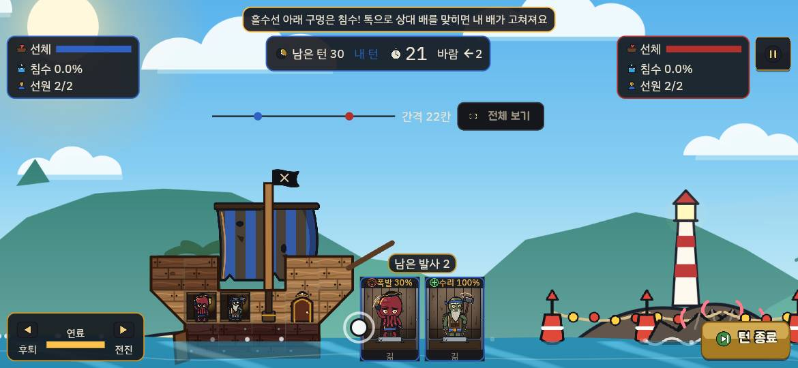
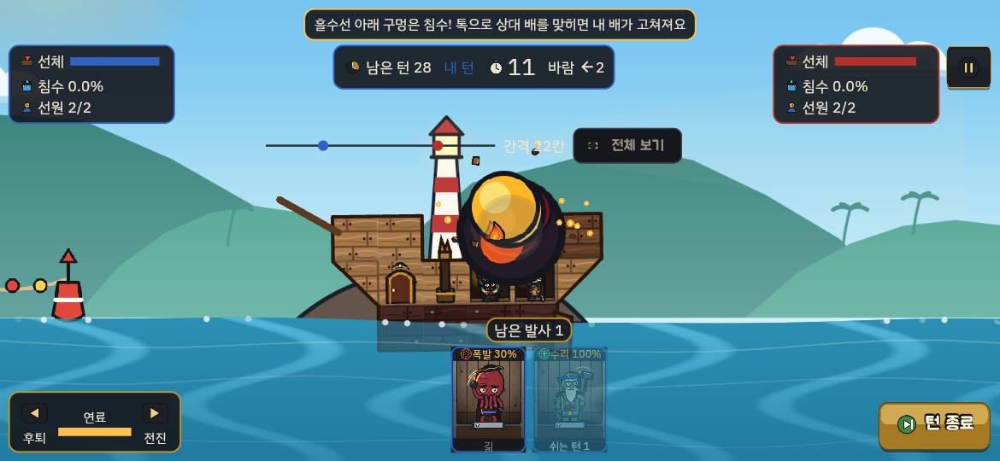
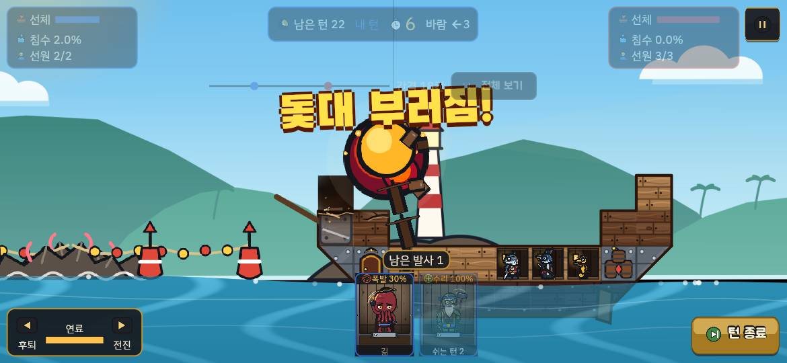
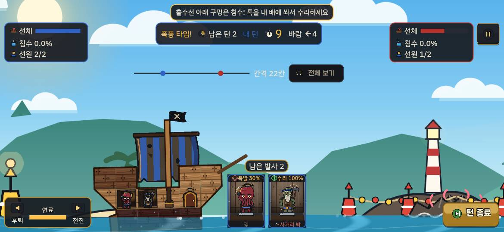
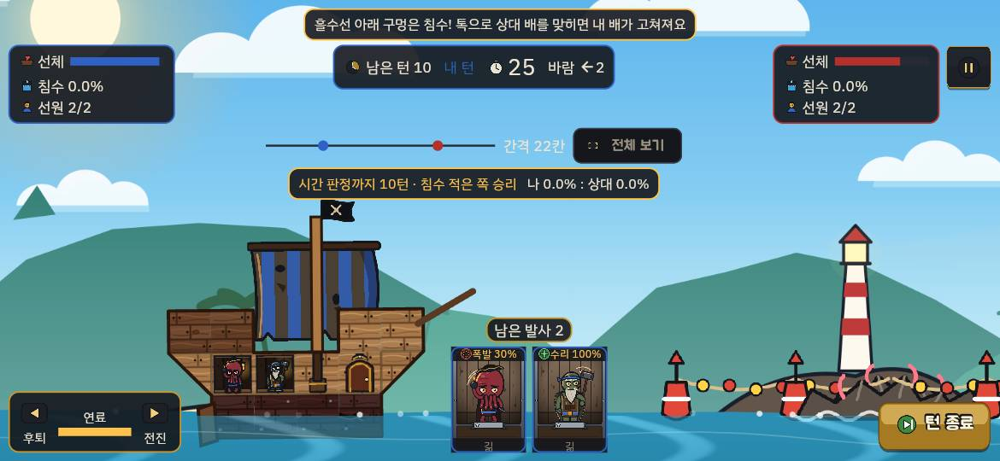
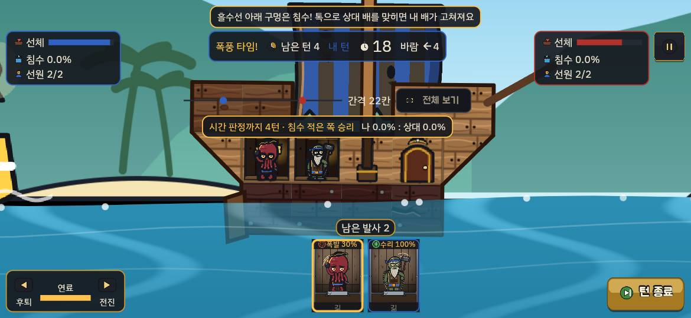
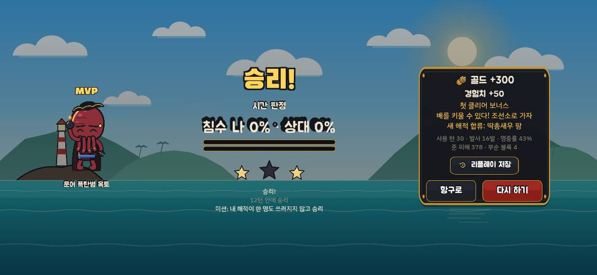
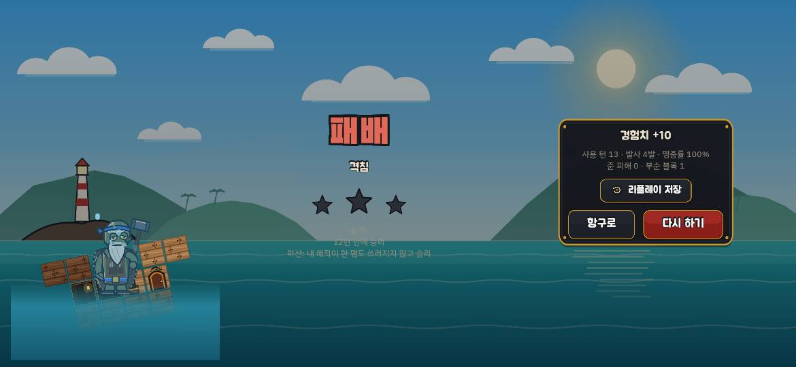
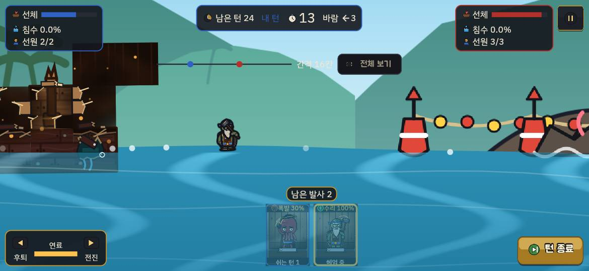

# A39 에이전트 플레이 점검: 보급 계열·해역 1 난이도·시간 판정 안내 전후 비교 (2026-10-07)

지난 점검: [2026-10-06-play-audit.md](2026-10-06-play-audit.md). 결정: ADR-090.

> **결론부터.**
> - **톡이 매 턴 상대를 쏠 수 있게 됐다.** BEFORE는 22칸에서 톡 카드에 '사거리 밖'이 붙었고, 앞으로 쏘면 피해 없이 조용히 떨어졌다. AFTER는 톡이 상대 배를 맞혀 명중 연출이 났고, 1-5에서는 톡 한 발로 상대 돛대가 부러졌다. 다만 **내 배가 고쳐지는 장면(수리 반짝임·'수리' 이름표)은 한 번도 보지 못했다**(아래 '확인하지 못한 것').
> - **1-5가 '구경하는 판'에서 '지는 판'으로 바뀌었다.** BEFORE 1-5는 30턴 내내 받은 피해 0으로 시간 판정 승리(별 2)였다. AFTER 1-5는 같은 진행(옥토·톡, 1단계 배)으로 **네 번 모두 11~13턴 만에 격침 패배**했다. 상대가 첫 두 턴에 뱃머리·선장실을 부수고 다가오며(간격 22→16칸) 계속 맞혔다. 자동 조작이 사람보다 서툴다는 점을 감안해도 '보통' AI 한 단계 차이로는 너무 가파르다.
> - **시간 판정 띠는 AFTER에서만, '남은 턴 10'부터 정확히 나왔다.** 문구·침수 비교가 읽힌다. 조준 확대 화면에서는 띠가 내 배 선실 위를 덮는다. 침수가 0% : 0%로 같을 때 무엇으로 이기는지는 띠가 알려 주지 않는다.

## 방법
- **빌드:** BEFORE `1657887`(A39 직전 main), AFTER `2bec4b1`(A39 병합 main). 저장소 밖 임시 worktree에서 임시 `flutter create --platforms=web` 뒤 `flutter build web --release`로 만들었다. 점검 뒤 worktree·생성 파일을 지웠다.
- **실행:** 지난 점검과 같다. 포트를 나눠 띄우고 헤드리스 Chrome(puppeteer-core, GPU ANGLE d3d11)으로 1170×540·2배 밀도에서 좌표로 조작했다. 한 번에 한 빌드만 돌렸다.
- **조준:** 카드를 누르면 고른 해적이 화면 (447, 268) 근처로 확대되므로, 그 점에서 (−222, +88)px 당겼다(22칸). 간격이 18칸으로 줄어든 뒤에는 (−201, +80)px로 줄였다.
  - 턴 반복은 "내 턴 감지(윗줄 '내 턴' 글자색) → 옥토 → 톡 → 턴 종료"로 자동화했다.
  - 설정의 **'2발 뒤 자동 턴 종료'가 켜져 있어** 두 발을 쏘면 턴이 바로 넘어간다.
- **진행 건너뛰기:** IndexedDB `progress/box/state` JSON을 두 빌드에 같은 값으로 넣었다.
  - 튜토리얼 3: `tutorialDone 2`, `matchesPlayed 2`
  - 1-5: `tutorialDone 3`, `matchesPlayed 7`, 별 t-1~t-3 3개·1-1~1-4 2개, 골드 450, 레벨 3, 보유 해적 없음(옥토·톡 기본 덱), 배 1단계(6×5·선실 2)
- **한계**
  - 자동 조작이라 사람보다 조준이 단순하다. 바람·간격 변화에 맞춰 세밀하게 고치지 않았다.
  - 초기에 도구 문제(부분 캡처가 창 크기를 바꿔 입력이 씹힘, 턴 감지 오판)로 AFTER 튜토리얼 3의 앞 4~5턴과 AFTER 1-5 1·2차의 여러 턴을 쏘지 못했다. 3·4차는 고친 뒤 돌렸다.
  - 1-5는 실제 플레이어보다 약한 편성이다. 1-4 보상 폴리와 배 키우기(골드 450이면 살 수 있음)를 넣지 않았다.
  - 소리·실기기 손맛은 확인하지 않았다.

## 장면별 전후 비교
| 장면 | BEFORE (1657887) | AFTER (2bec4b1) | 관찰 |
|---|---|---|---|
| 튜토리얼 3 시작 |  |  | 안내 문구: BEFORE "톡을 내 배에 쏴서 수리하세요", AFTER "톡으로 상대 배를 맞히면 내 배가 고쳐져요". BEFORE 톡 카드에는 22칸에서 '사거리 밖'이 붙는다. AFTER는 '길'(쏠 수 있음)이다 |
| 톡 발사 | 앞으로 쏘면 상대 쪽 물에 조용히 떨어지고 피해가 없다. 쏜 뒤 '쉬는 턴 1' |  | AFTER: 톡 탄이 상대 배에 맞아 폭발·파편 연출이 난다. 옥토와 톡을 연달아 맞히면 "연속 명중!"도 뜬다 |
| 톡이 돛대를 부숨 (1-5) | (해당 없음) |  | AFTER: 약한 톡 한 발에 "돛대 부러짐!"이 나왔다. 그 뒤 카메라가 약 1.5초 만에 내 배로 돌아온다. 이때 내 배에서 수리 반짝임·'수리' 이름표는 보이지 않았고 침수 2.0%도 그대로였다 |
| 시간 판정 띠 (남은 턴 10) |  |  | AFTER: "남은 턴 10"이 되자 거리 막대 밑에 "시간 판정까지 10턴 · 침수 적은 쪽 승리 · 나 0.0% : 상대 0.0%"가 떴고 1턴까지 매 턴 줄었다. 상대 턴(흐려진 HUD)에도 남는다. 남은 턴 11 이상에서는 없다. BEFORE: 남은 턴 2('폭풍 타임')까지 띠가 없다 |
| 띠와 조준 확대 | — |  | 카드를 눌러 내 배가 확대되면 띠가 위층 선실 칸과 해적 머리 바로 위를 덮는다. 당기는 점(해적)은 가리지 않아 조작은 됐다. 거리 막대도 원래 배 위에 겹친다(기존). '폭풍 타임!' 표시와 함께 윗줄이 길어져도 겹침은 없었다 |
| 1-5 보스 결과 |  |  | BEFORE: 30턴 시간 판정 승리(0% : 0%), 별 2. AFTER: 13턴 격침 패배. 패배 화면의 가라앉는 배에 설계도 격자선과 각진 사각 물이 여전히 보인다(지난 점검 버그 3) |
| 1-5 상대 위협 | 30턴 동안 선체·침수·선원 그대로 |  | AFTER: 상대(하마·핀·샤키)가 첫 두 턴에 내 뱃머리와 선장실을 부쉈다. 선장실을 잃자 옥토·톡 모두 쏜 다음 턴을 쉬게 됐다('쉬는 턴 2', ADR-038). 이어서 돛대가 부러지고 톡이 바다에 빠졌으며, 간격이 22→16칸으로 줄었다 |

## 판당 시간·결과
벽시계는 출항부터 결과 화면까지(대략, 자동 조작 지연 포함). '받은 피해'는 HUD 기준이다.

| 판 | 빌드 | 벽시계 | 턴 | 결과 | 발사 | 명중률 | 준 피해·부순 블록 | 받은 피해 | 별 |
|---|---|---|---|---|---|---|---|---|---|
| 튜토리얼 3 | BEFORE | 약 255초 | 30 | 마지막 턴 **격침 승리** | 19 (톡 헛발 포함) | 31% | 428 · 5 (상대 해적 1명 쓰러짐) | 0 (침수 0%) | 3 |
| 튜토리얼 3 | AFTER | 약 345초 | 30 | **시간 판정 승리** (0% : 0%, 선체 비율로 갈림) | 14 (앞 4~5턴 도구 문제로 못 쏨) | 42% | 24 · 4 | 0 (침수 0%) | 3 |
| 1-5 보스 | BEFORE | 약 200초 | 30 | 시간 판정 승리 (0% : 0%) | 16 | 43% | 378 · 4 | **0** | 2 (12턴 안 승리 실패) |
| 1-5 보스 1차 | AFTER | 약 150초(추정) | 11 | **격침 패배** | 2 | 100% | 0 · 1 | 격침 | 0 |
| 1-5 보스 2차 | AFTER | 약 190초 | 13 | **격침 패배** | 4 | 100% | 0 · 1 | 격침 (침수 8%까지 보임) | 0 |
| 1-5 보스 3차 | AFTER | 약 170초 | 13 | **격침 패배** | 6 | 100% | 0 · 2 | 격침 | 0 |
| 1-5 보스 4차 | AFTER | 약 160초 | 13 | **격침 패배** | 4 | 100% | 0 · 3 | 격침 | 0 |

- 1·2차는 도구 문제로 내 턴 일부를 날렸다. 3·4차는 매 턴 쏘려고 했다. 그래도 선장실을 잃은 뒤에는 두 해적이 한 턴씩 쉬었다. 4차에는 톡이 바다에 빠져 두 턴을 못 쐈다. 그래서 6~7번의 내 턴에 4~6발밖에 못 쐈다.
- AFTER 1-5의 명중률 100%는 대부분 뱃머리 철판 방패와 선체에 맞은 것이다. 해적 피해는 0, 부순 블록은 1~3개였다.

## 버그·화면 결함
| # | 빌드 | 내용 | 근거 |
|---|---|---|---|
| 1 | AFTER | **시간 판정 띠 색이 실제 판정과 다를 수 있다.** 띠는 침수량을 그대로 비교해 `mine < theirs`면 초록으로 칠한다. 그런데 시뮬은 차이가 1%p(`floodTieMargin = 10`) 이내면 선체 내구도 비율로 승패를 정한다. 그래서 0.5% : 1.0%면 띠는 초록('앞섬')인데 실제로는 선체에서 질 수 있다. 0% : 0%일 때는 흰색이고 무엇으로 갈리는지도 안 보인다(AFTER 튜토리얼 3이 0% : 0% 시간 판정 승리로 끝났다) | `app/lib/ui/hud/time_verdict_bar.dart:44`, `packages/pb_sim/lib/src/match/judge.dart:30-47` |
| 2 | 둘 다 | **'쉬는 턴 1'이 '이번 턴에 이미 쐈음'을 뜻한다.** 쏘면 쿨다운이 `cooldownTurns + 1`이 되고 카드에 그 값이 그대로 나온다. 그래서 옥토·톡(쿨다운 0)도 쏜 직후 '쉬는 턴 1'이 붙지만 다음 내 턴에는 다시 쏠 수 있다. 지난 점검의 "문어는 쏜 뒤 쉬는 턴 1" 관찰도 일부는 이 표시 때문이었을 수 있다. 선장실을 잃으면 '쉬는 턴 2'가 되어 실제로 한 턴을 쉰다 | `app/lib/ui/hud/pirate_cards.dart:85`, `packages/pb_sim/lib/src/pirate/crew.dart:71` |
| 3 | 둘 다 | 패배 결과 화면의 가라앉는 배에 설계도 격자선이 보이고, 물이 각진 반투명 사각형으로 그려진다(지난 점검 버그 3, 아직 남음) | AFTER 1-5 패배 캡처 |
| 4 | AFTER | 바다에 빠진 해적(톡) 카드를 누르면 쏠 수 없는데도 카메라가 바다 위 해적으로 확대된다. 그 상태로 3초 넘게 머물러 내 배 상황이 안 보인다 | 4차 25턴 캡처 |
| 5 | 둘 다 | 보스 배너("보스 등장!")가 뜬 동안에도 턴 타이머가 흐른다. 첫 턴이 21초부터 시작하는 것도 그대로다(지난 점검 버그 6·제안 7) | 1-5 첫 턴 캡처 |

(지난 점검 버그 4 '다음 목표 카드가 해역 인트로를 건너뜀'은 두 빌드 모두 고쳐져 있었다. 카드의 [도전]에서 인트로가 먼저 나왔다.)

## 재미 관찰
### 좋아진 순간
- **톡이 '두 번째 대포'가 됐다.** 매 턴 옥토와 톡 두 발을 상대에게 쏜다. 연속 명중 표시가 나오고, 톡 한 발에 돛대가 부러지는 장면도 나왔다. BEFORE에서 톡은 22칸에서 '사거리 밖'이라 매 턴 할 일이 없었다.
- **1-5에서 처음으로 긴장이 생겼다.** 상대 탄이 내 뱃머리를 부수고, 돛대가 넘어가고, 해적이 바다에 빠진다. BEFORE 1-5는 30턴 동안 내 배가 한 번도 맞지 않았다.
- **시간 판정 띠는 남은 10턴을 '마무리 구간'으로 만든다.** 숫자가 매 턴 줄고, 침수 비교가 같은 줄에 있어 시간 판정 규칙이 처음으로 화면에 드러났다.

### 지루하거나 답답한 순간
- **AFTER 1-5는 손쓸 틈 없이 무너진다.** 선장실을 잃으면 두 해적 모두 격턴으로만 쏜다. 그다음 돛대·선실이 무너지고 해적이 바다에 빠지면 쏠 해적이 없다. 반격 수단이 사라진 채 몇 턴을 버티다 가라앉는다. "아깝게 졌다"보다 "아무것도 못 했다"에 가깝다.
- **튜토리얼 3에서 수리를 볼 수 없다.** 상대(쉬움)가 30턴 동안 한 번도 내 배를 맞히지 못했다. 그래서 "톡으로 맞히면 내 배가 고쳐져요"를 가르치는 판인데 고칠 구멍이 생기지 않았다. 1-5에서는 피해가 대부분 '부서진 칸'(못 고침)이라 수리가 보이지 않았다.
- **튜토리얼 3 AFTER가 0% : 0% 시간 판정으로 끝났다.** 톡 피해(블록 20)가 약하고 자동 조준이 단순해서 30턴 안에 격침하지 못했다. 사람이라면 다를 수 있다.

## 제안
`[규칙·수치]`는 설계서·BALANCE.md 수정 승인이 먼저 필요하다. `[앱]`은 화면만 고친다.

1. **[규칙·수치] 1-5 난이도 계단을 완만하게 한다.** 1-3·1-4·1-5가 한꺼번에 '보통'이 되면서 1-5는 1단계 배·기본 덱으로 네 번 모두 13턴 안에 졌다.
   - 1-5만 '쉬움'과 '보통' 사이 다이얼을 쓰거나(BALANCE A부 AI 다이얼), 첫 1~2턴 상대 명중 오차를 크게 한다.
   - 또는 1-5 보스에서 상대가 다가오는 속도를 늦춘다.
   - `sim_runner --stage 1-5`로 '1단계 배 + 옥토·톡' 대 1-5 승률을 따로 잰다. ADR-090의 67~69%는 AI 대 AI 수치라 사람 초반 편성을 대표하지 않는다.
2. **[규칙·수치] 선장실 페널티를 초반에 덜 아프게 한다.** 첫 두 턴에 선장실을 잃자 공격 횟수가 절반이 됐다. 해역 1에서는 선장실 블록 체력을 올리거나, 페널티를 '+1턴'이 아닌 다른 효과로 바꾸는 것을 검토한다(설계서 §3.3, ADR-038).
3. **[앱] 시간 판정 띠를 실제 판정과 맞춘다**(버그 1).
   - 차이가 1%p 이내면 흰색으로 두고 "침수 같음 → 선체 비교"처럼 다음 기준을 보인다.
   - 시뮬 `floodTieMargin`을 띠에서 그대로 쓴다. 문구는 ko·en을 함께 추가한다.
4. **[앱] 쏜 직후 카드 표시를 '쉬는 턴 n'과 구분한다**(버그 2). 이번 턴에 쏜 해적은 "발사 완료"로, 다음 턴에도 못 쏘는 해적만 "쉬는 턴 n-1"로 보인다.
5. **[앱] 보급 효과를 내 배에서 보이게 한다.** 톡이 맞힌 순간 카메라는 상대 배에 있다. 수리가 일어나면 내 배 쪽에 작은 '수리 +n칸' 알림을 띄우거나, HUD 내 선체 막대가 차오르는 연출을 넣는다. 고칠 구멍이 없으면 "고칠 곳 없음"을 짧게 보여 준다.
6. **[규칙·수치 또는 데이터] 튜토리얼 3에서 수리를 한 번은 보게 한다.** 내 배가 흘수선 아래 구멍 1~2칸을 가진 채로 시작하거나, 상대의 첫 발이 반드시 맞게 한다. 튜토리얼 판 정의를 바꾸므로 설계서 §13.1 확인이 필요하다.
7. **[앱] 조준 확대 때 시간 판정 띠를 비키게 한다.** 조준 중에는 띠를 반투명으로 하거나 윗줄 오른쪽으로 접는다.
8. **[앱] 바다에 빠진 해적 카드를 누르면 카메라를 옮기지 않는다**(버그 4).

## 확인하지 못한 것
- **톡 명중 뒤 내 배의 수리 연출('수리' 이름표·반짝임)**. AFTER에서 내 배가 다친 상태로 톡이 상대를 맞힌 것은 두 번이었다(1-5 3차 28턴, 4차 22턴). 둘 다 내 배에서 수리 표시를 보지 못했고 침수도 줄지 않았다. 내 배 피해가 대부분 '부서진 칸'이라 고칠 '구멍'이 없었을 수 있다. 수리 로직은 A39 단위 테스트가 다루지만, 화면 연출은 이번 점검으로 확인되지 않았다.
- 1-5를 실제 플레이어 편성(폴리 합류·배 키우기)으로는 하지 않았다. 그 편성에서 이길 수 있는지는 모른다.
- 1-3·1-4·1-12(어려움)는 하지 않았다.
- 시간 판정 띠를 1-5처럼 윗줄이 위로 올라간 배치(안내 문구 없음)에서는 보지 못했다. 판이 13턴 안에 끝났기 때문이다.
- 영어 문구, 소리, 실기기는 확인하지 않았다.
