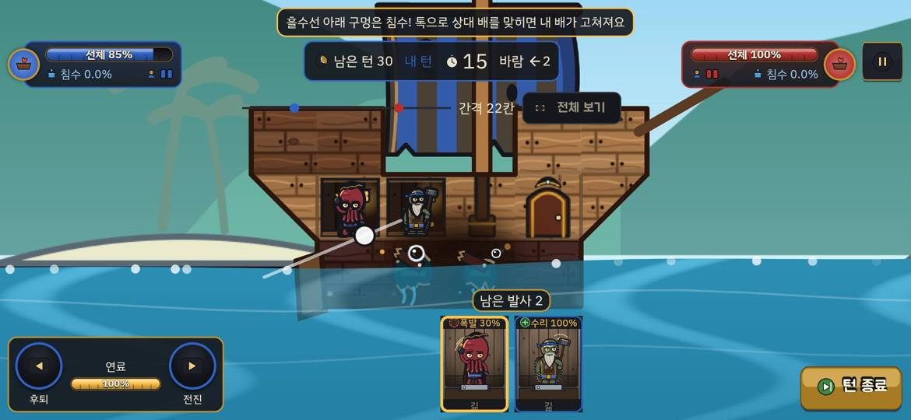
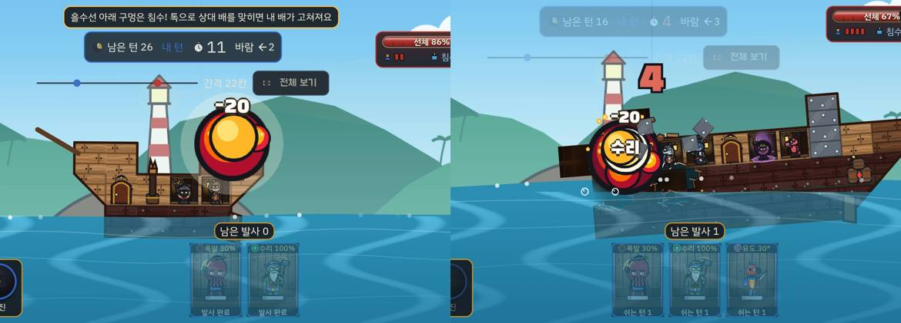
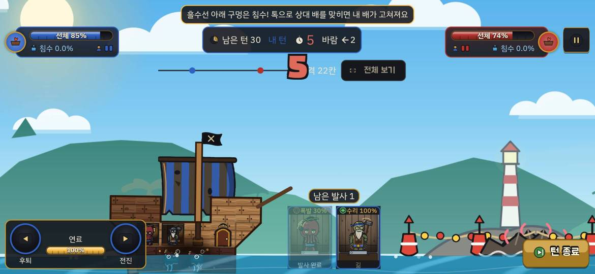
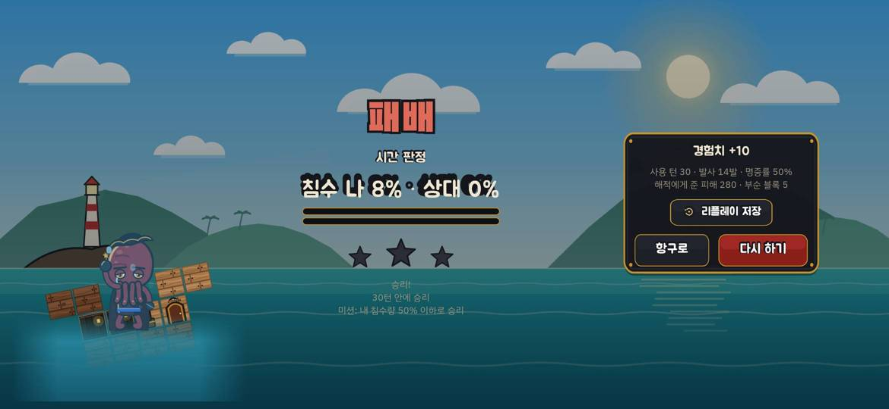
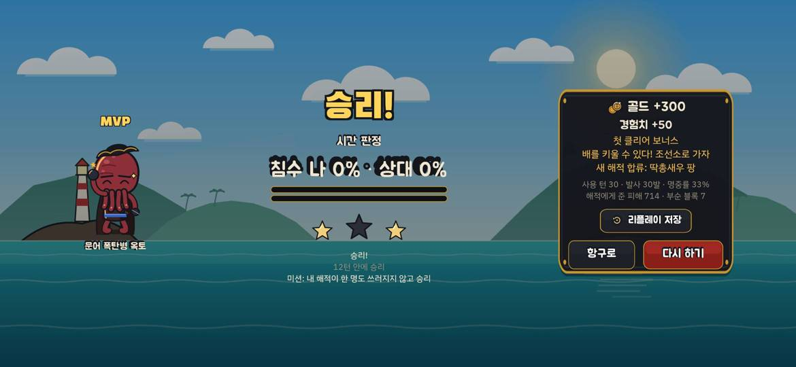
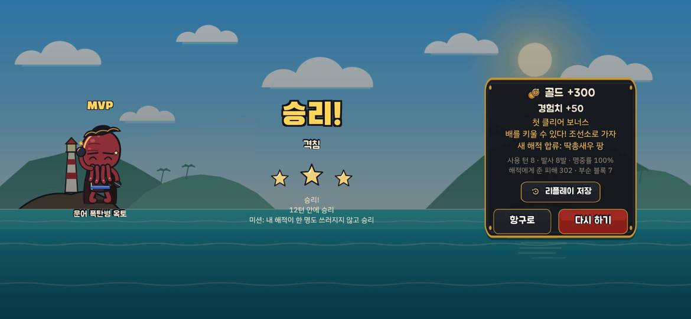
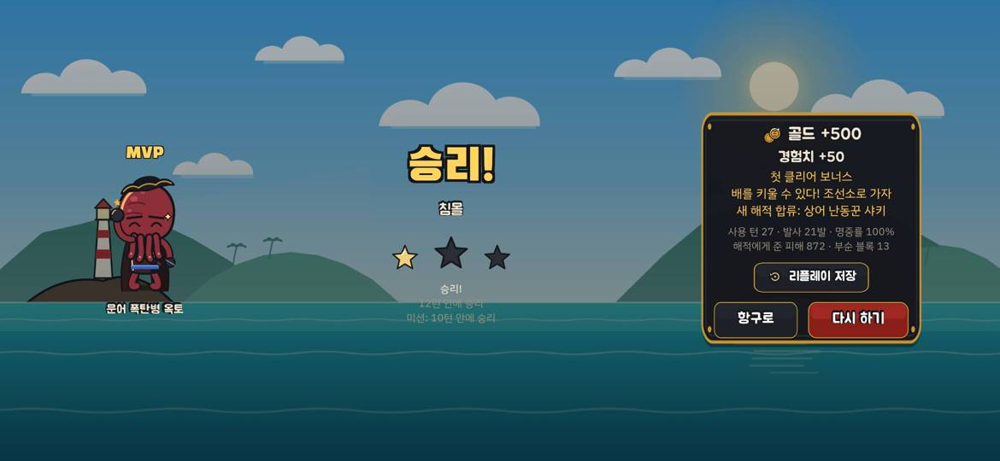

# A41 에이전트 플레이 점검: 튜토리얼 3 구멍 시작·1-5/1-12 쉬움+기믹·HUD 후속 (2026-10-07)

지난 점검: [2026-10-07-a39-play-audit.md](2026-10-07-a39-play-audit.md). 결정: ADR-092.

> **결론부터.**
> - **튜토리얼 3에서 수리는 '일어나지만' 보이지 않고, 늦으면 판을 진다.** 시작 선체 85%와 맨 아래 줄 구멍 2칸, 물방울은 바로 보인다. 톡이 상대를 맞히면 내 선체가 100%로 돌아온다(두 판 모두 확인). 그러나 튜토리얼 3에서는 착탄 지점의 **'수리' 이름표를 한 번도 보지 못했다**. 1-12에서 톡이 블록을 부순 한 발에만 떴다(버그 1). 또 1단계 배에는 펌프가 없어서, 첫 턴에 고치지 못해 들어온 물(턴당 4%)이 끝까지 남는다. 2차 판은 첫 턴 수리를 놓쳐 침수 8.0% : 0.0%로 **시간 판정 패배(별 0)**였다.
> - **1-5는 다시 '구경하는 판'이 됐다.** 기본 덱(옥토·톡)·1단계 배로 30턴 내내 **받은 피해 0**이었고, 시간 판정(0% : 0%, 선체 비교) 승리, 별 2였다. 폴리를 넣고 배를 2단계로 키우자 **8턴 만에 격침, 별 3, 받은 피해 0**이었다. A39 '보통'(네 번 모두 13턴 안 패배)과 비교하면 반대쪽 끝으로 넘어갔다.
> - **HUD 후속은 대부분 의도대로다.** 쏜 직후 카드에 '발사 완료'가 붙는다. 시간 판정 띠 색은 시뮬 판정과 같고, 0% : 0%면 '침수 비슷: 선체 비교'가 붙는다(이길 때 초록, 질 때 빨강). 패배 화면 물 띠는 양옆이 풀렸고 설계도 격자선도 사라졌다. 결과 줄은 '해적에게 준 피해'로 바뀌었다. 1-12(쉬움+초계선)는 3단계 배로 27턴 만에 침몰 승리(별 1)를 거뒀고, 선체는 90%까지만 내려갔다.

## 방법
- **빌드:** main `b844744`(A41 병합). 저장소 밖 임시 worktree에서 임시 `flutter create --platforms=web` 뒤 `flutter build web --release`로 만들었다. 점검 뒤 worktree·생성 파일을 지웠다.
- **실행:** 헤드리스 Chrome(puppeteer-core, GPU ANGLE d3d11)으로 1170×540·2배 밀도로 띄우고 좌표로 조작했다. 이번에는 브라우저 연결 하나를 오래 붙잡는 작은 명령 서버를 썼다. 지난 점검처럼 연결을 끊었다 붙이면 화면 크기 설정이 풀려 레이아웃이 깨졌기 때문이다.
- **조준:** 카드를 누르고 1.5초 기다리면 고른 해적이 화면 (451, 250) 근처로 확대된다. 그 점에서 (−222, +88)px 당겼다. 간격은 모든 판에서 22칸 그대로였다.
  - 내 턴 감지는 '턴 종료' 버튼의 금색 픽셀로 했다. 윗줄 '내 턴' 글자색은 상대 턴에 반투명 패널 뒤 하늘색이 섞여 오판했다.
  - 턴마다 두 발을 쏘았다: 튜토리얼 3·1-5 기본 덱은 옥토 → 톡, 폴리 편성은 옥토 → 폴리(못 쏘면 톡).
- **진행 건너뛰기:** IndexedDB `progress/box/state` JSON을 고쳤다. 덱은 `fleet/box/deck`(쉼표로 이은 id)에 넣었다.
  - 튜토리얼 3: `tutorialDone 2`, 별 t-1·t-2
  - 1-5 기본: `tutorialDone 3`, 별 1-1~1-4 2개, 골드 450, 레벨 3, 보유 해적 없음, 배 1단계
  - 1-5 폴리: 보유 `p26_polly`, `ship.stage 2`(설계도 칸은 비워 두어 2단계 추천 '밸런스'가 나감, 선실 3), 덱 옥토·톡·폴리
  - 1-12: 별 1-1~1-5, 보유 수리·폴리·팡, `ship.stage 3`(추천 밸런스, 선실 3), 덱 옥토·톡·폴리
- **한계**
  - 자동 조작은 바람·간격에 맞춰 조준을 고치지 않는다. 1-12는 명중률 100%가 나올 만큼 잘 맞았지만 사람의 조준과는 다르다.
  - 스크린샷을 자주 찍어 게임 시간이 느려졌다. 그래서 벽시계는 실제보다 길다.
  - 튜토리얼 3 1차 판은 처음 몇 턴의 자동 조작이 서툴렀다(한 턴에 톡을 늦게 쏨). 2차 판 첫 턴은 도구 점검에 썼다(옥토 카드만 누르고 쏘지 않음).
  - 1-12 첫 시도는 저장 편집 실수로 무효다(아래 '버그 4'). 그 판은 한 발도 쏘지 않고 시간 판정 패배로 끝났다. 표에는 다시 한 판만 넣었다.

## 장면별 확인
| 장면 | 화면 | 관찰 |
|---|---|---|
| 튜토리얼 3 시작 |  | 시작부터 선체 85%다. 카드를 누르면 배가 확대되고, 맨 아래 줄 가운데 두 칸에 금 간 판자와 물방울이 보인다. 안내 문구는 "흘수선 아래 구멍은 침수! 톡으로 상대 배를 맞히면 내 배가 고쳐져요"로, 구멍을 실제로 보며 읽을 수 있다. 다만 전투 준비 화면의 내 배 그림에는 구멍이 없다. 첫 턴에는 침수가 0.0%이고, 턴이 끝나야 4.0%로 오른다 |
| 톡 명중 (수리) |  | 왼쪽은 튜토리얼 3이다. 톡 탄이 상대 배에 맞는 순간 내 선체 막대가 85% → 100%로 찬다. 착탄 지점에는 피해 숫자 '-20'과 폭발만 있고, **'수리' 이름표는 없다**. 0.33초 간격으로 찍은 9장 모두 같았고, 1차·2차 판의 수리 장면도 같았다. 오른쪽은 1-12다. 톡이 상대 블록을 부순 발사에서는 '수리' 이름표가 폭발 위에 떴다(버그 1) |
| 쏜 뒤 카드 |  | 옥토 카드 아래에 '발사 완료'가 붙는다('쉬는 턴 1'이 아님). 선장실을 잃은 판에서는 다음 턴 카드에 '쉬는 턴 1'이 나왔다(ADR-038대로) |
| 시간 판정 띠 |  | 위: 0% : 0%이고 내 선체가 앞서면(94% : 46%) 초록과 '침수 비슷: 선체 비교'. 가운데: 8.0% : 0.0%면 빨강, 선체 문구 없음. 아래: 0% : 0%이고 내 선체가 뒤지면(71% : 100%) 빨강과 '침수 비슷: 선체 비교'. 세 경우 모두 실제 판정과 같다. 조준 확대 때 띠가 내 배 선실 위를 덮는 것은 그대로다(지난 제안 7) |
| 튜토리얼 3 패배 |  | 침수 나 8% · 상대 0%, 시간 판정 패배. 물 띠는 양옆이 부드럽게 풀렸고 설계도 격자선이 없다. 아래쪽 끝은 아직 직선으로 끊겨 보인다(작음). 결과 줄은 '해적에게 준 피해 280 · 부순 블록 5'다 |
| 1-5 기본 덱 결과 |  | 시간 판정 승리(0% : 0%), 별 2. 30턴 동안 내 선체는 100%, 침수 0%였다. 상대는 선체 45%까지 내려갔고 해적 두 명이 쓰러졌다. 그래도 30턴 안에 가라앉히지는 못했다 |
| 1-5 폴리·2단계 결과 |  | 8턴 격침, 별 3, 발사 8발 명중률 100%. 옥토 → 폴리 연속 명중이 매 턴 나왔고, 셋째 내 턴에 '선실 직격'과 피해 숫자 세 개(-88·-36·-24)가 한자리에 겹쳤다 |
| 1-12 결과 |  | 침몰 승리 27턴, 별 1(12턴·10턴 미션 실패). 상대 침수가 턴마다 4~8%p씩 올라 88%에서 가라앉았다. 내 선체는 100 → 90%까지만 내려갔고, 톡 수리로 94%까지 다시 올랐다. 판 내내 간격은 22칸이었다 |

## 판 결과
벽시계는 출항부터 결과 화면까지다(스크린샷 지연 포함). '받은 피해'는 HUD 선체·침수 기준이다.

| 판 | 편성 | 벽시계 | 턴 | 결과 | 발사 | 명중률 | 준 피해·부순 블록 | 받은 피해 | 별 |
|---|---|---|---|---|---|---|---|---|---|
| 튜토리얼 3 1차 | 옥토·톡, 1단계 | 약 505초 | 30 | 시간 판정 **승리** (0% : 0%, 선체 비교) | 18 | 38% | 256 · 4 | 시작 85% → 첫 턴 톡 수리로 100% → 끝 94%, 침수 0% | 3 |
| 튜토리얼 3 2차 | 옥토·톡, 1단계 | 약 600초 | 30 | 시간 판정 **패배** (8% : 0%) | 14 | 50% | 280 · 5 | 2턴 늦은 수리로 **침수 8% 고정**. 선장실을 잃고 끝 선체 63% | 0 |
| 1-5 (1) | 옥토·톡, 1단계 | 약 395초 | 30 | 시간 판정 승리 (0% : 0%) | 30 | 33% | 714 · 7 | **0** (선체 100%, 침수 0%) | 2 |
| 1-5 (2) | 옥토·톡·폴리, 2단계 | 약 205초 | 8 | **격침 승리** | 8 | 100% | 302 · 7 | **0** | 3 |
| 1-12 | 옥토·톡·폴리, 3단계 | 약 470초 | 27 | **침몰 승리** | 21 | 100% | 872 · 13 | 선체 최저 90%, 침수 0% | 1 |

- 지난 점검(A39, 1-5 '보통'): 같은 1단계 기본 덱으로 네 번 모두 11~13턴 격침 패배였다. 그 전 '쉬움'에서는 30턴 피해 0이었다. A41 1-5는 그 '쉬움' 판과 거의 같은 모양이다. 뱃머리 철판 방패는 옥토(투척)에는 걸리지 않아 체감이 없었다.

## 버그·화면 결함
| # | 내용 | 근거 |
|---|---|---|
| 1 | **보급탄 결과 이름표('수리'·'고칠 곳 없음')가 블록을 부수지 못한 발사에서는 뜨지 않는다.** 수리 자체는 된다(선체 85 → 100%). 튜토리얼 3의 수리 3번은 모두 이름표가 없었다. 1-12에서 톡이 블록을 부순 발사에서는 '수리'가 떴다. 추정 원인: 블록을 부수지 않은 발사는 `breakMs`가 0이다. 그러면 마지막 착탄 이벤트를 꺼내는 같은 프레임에 `isDone`이 되어 `playback = null`이 된다. 그 뒤 `dispatch`가 `_shooter`를 읽으면 null이고, `supplyTag(spec=null)`은 아무것도 띄우지 않는다. 톡(블록 피해 30)은 대개 블록을 부수지 못하므로 거의 항상 이 경우다. 같은 이유로 그런 발사의 탄종 이름표(`HitTag.ofAmmo`)와 등급 연출(`tier`)도 빠질 수 있다. 단위 테스트는 `HitTag.ofSupply`만 보고, 연결 경로는 다루지 않는다 | `app/lib/battle/battle_session.dart:107`·`:292`, `app/lib/game/battle_game.dart:188`·`:195`, `app/lib/game/battle_cues.dart:64`·`:272`, `app/lib/battle/playback.dart:91` |
| 2 | **튜토리얼 3이 자기 장치 때문에 질 수 있다.** 1단계 추천 배에는 펌프가 없어 들어온 물이 빠지지 않는다. 첫 내 턴에 톡을 맞히지 못하면 턴마다 4%씩 쌓인다. 상대(쉬움, 침몰형)는 내 배를 거의 잠기게 하지 못하므로, 시간 판정이 '침수 적은 쪽'으로 상대 승리가 된다. 2차 판은 8% : 0%로 졌다. 수리는 구멍만 막고 물은 빼지 않는다는 점도 화면이 알려 주지 않는다 | 2차 판 HUD(26턴부터 끝까지 8.0%), 결과 화면 |
| 3 | 보스 배너("보스 등장!")가 떠 있는 동안 턴 타이머가 흐른다. 1-5·1-12 모두 첫 턴이 24초에서 시작했고, 이야기 넘김과 겹치면 16초까지 줄었다(지난 점검 버그 5) | 1-5·1-12 첫 턴 캡처 |
| 4 | (저장 편집으로 생긴 경우) 저장된 덱 해적 수가 선실보다 많으면 전투 준비 화면은 앞 3명(옥토·톡·폴리)을 보여 주고 코스트는 4명분(12/20)을 센다. 그런데 실제 전투는 기본 덱(옥토·톡)으로 나간다. 보통 플레이에서도 큰 설계도로 4명 덱을 저장한 뒤 작은 설계도로 바꾸면 생길 수 있다 | 1-12 첫 시도 준비 화면·전투 화면 |
| 5 | 연속 피해 숫자 세 개와 '선실 직격' 이름표가 한자리에 겹쳐 읽기 어렵다(-88·-36·-24) | 1-5 (2) 셋째 턴 캡처 |
| 6 | 패배 결과 화면의 물 띠는 양옆이 풀렸지만 아래 끝은 직선으로 끊겨 보인다(작음) | 튜토리얼 3 패배 캡처 |

## 재미 관찰
### 좋아진 순간
- **튜토리얼 3의 '문제'가 처음부터 눈에 보인다.** 선체 85%와 바닥의 물방울 덕분에 "고쳐야 한다"가 첫 화면에서 읽힌다. 톡을 맞히자 선체 막대가 한 번에 100%로 차는 것도 HUD로는 알 수 있다.
- **시간 판정 띠가 정직해졌다.** 0% : 0%에서도 이기는지 지는지 색이 알려 주고, '선체 비교'라는 다음 기준이 보인다. 마지막 10턴의 긴장이 지난 점검보다 분명하다.
- **'발사 완료'로 헷갈림이 사라졌다.** 쏜 직후 '쉬는 턴 1'에 놀랄 일이 없다.
- **1-12는 손맛이 있었다.** 상대 침수가 매 턴 4~8%p씩 오르는 것이 보였고, 마지막에 침몰 연출로 끝났다. 내 배도 적당히(최저 90%) 맞았다.

### 지루하거나 답답한 순간
- **1-5 기본 덱은 30턴 동안 아무 일도 일어나지 않는다.** 상대 쉬움 AI가 한 번도 내 배를 맞히지 못했다. 방패 기믹은 옥토 같은 투척 계열에는 체감이 없다. 결국 0% : 0% 시간 판정 승리로, 지난 '쉬움' 때와 같은 구경 판이었다.
- **1-5 폴리·2단계는 너무 쉽다.** 4번의 내 턴, 8발로 끝났다. 중간 보스의 무게가 없다.
- **튜토리얼 3에서 수리의 보상이 약하다.** 착탄 지점 이름표가 없어 "톡이 무엇을 했는지"는 선체 막대를 보고 있던 사람만 안다. 늦게 고치면 물이 남아 지는데, 그 이유도 화면에서 설명되지 않는다.

## 제안
`[규칙·수치]`는 설계서·BALANCE.md 수정 승인이 먼저 필요하다. `[앱]`은 화면만 고친다.

1. **[앱] 보급탄 이름표가 실제로 뜨게 한다**(버그 1).
   - `dispatch`에 쏜 해적 정의를 넘긴다. 예: `takeCues` 전에 `_shooter`를 잡아 두거나, `_finishPlayback`에서 마지막 묶음과 함께 슈터를 전달한다.
   - 블록을 부수지 않는 발사로 '수리' 이름표가 뜨는지 확인하는 위젯·게임 테스트를 하나 넣는다.
2. **[규칙·수치] 튜토리얼 3이 시작 구멍 때문에 지지 않게 한다**(버그 2). 다음 중 하나를 고른다(설계서 §15.2, BALANCE.md A5.4).
   - 튜토리얼 3 내 배에 펌프를 넣는다.
   - 수리가 구멍을 막을 때 그 칸으로 들어온 물도 일부 뺀다.
   - 튜토리얼 3만 시간 판정 대신 '상대 침수 50% 또는 30턴 생존'으로 이기게 한다.
   - 첫 턴이 지나기 전에는 시작 구멍으로 물이 들지 않게 한다.
3. **[앱] 수리했을 때 내 배 쪽에도 알린다.** 카메라가 상대 배에 있으므로, 내 HUD 선체 막대 옆에 '+15%' 같은 짧은 숫자를 띄운다. 물은 남는다는 점을 튜토리얼 3 안내에 한 줄 더한다(ko·en 같이).
4. **[규칙·수치] 1-5 AI를 '쉬움'과 '보통' 사이로 둔다.** 쉬움은 30턴 피해 0, 보통은 13턴 안 패배로 두 끝이 모두 재미없다. BALANCE A부 AI 다이얼에 1-5 전용 중간값(명중 오차·첫 턴 지연)을 두고, `sim_runner --stage 1-5`로 '1단계 옥토·톡'과 '2단계 옥토·톡·폴리' 두 편성의 승률을 같이 잰다.
5. **[규칙·수치] 1-5 방패 기믹이 기본 덱에도 느껴지게 한다.** 지금은 직사만 절반이라 옥토·톡·폴리 편성에는 아무 영향이 없다. 계열과 관계없이 뱃머리 블록 내구도를 올리는 방식 등을 검토한다(설계서 §5.4).
6. **[앱] 보스 배너가 떠 있는 동안 턴 타이머를 멈춘다**(버그 3, 지난 제안 7).
7. **[앱] 덱이 선실보다 많을 때 전투 준비 화면을 실제 출전 덱과 맞춘다**(버그 4). 앞에서부터 선실 수만큼 자르고 코스트도 그 기준으로 센다. 또는 "덱을 다시 고르세요" 경고를 띄운다.
8. **[앱] 조준 확대 때 시간 판정 띠를 비키게 한다**(지난 제안 7, 이번에도 내 배 선실 위를 덮음).

## 확인하지 못한 것
- **'고칠 곳 없음' 이름표**: 한 번도 보지 못했다. 1-12에서 톡이 블록을 부수며 맞힌 다른 발사(선실 직격 -60)에도 이름표가 없었다. 다만 그때 내 배에 고칠 '구멍'이 있었는지는 화면으로 가릴 수 없었다.
- 버그 1의 원인은 코드를 읽고 추정한 것이다. 디버거로 확인하지 않았다.
- **헤엄치는 해적 카드를 눌렀을 때 카메라가 움직이지 않는지**: 이번 판들에서 내 해적이 바다에 빠진 적이 없어 보지 못했다(코드는 `focusSlot`이 `isAboard`를 보도록 바뀌었다, `app/lib/battle/ui_state.dart`).
- 1-5를 '보통'에 가까운 사람 조작으로 여러 번 하지 않았다. 판별 표본은 편성마다 한 판이다.
- 1-12를 4명 편성으로 하지 못했다. 3단계 추천 배의 선실이 3칸이라 팡은 나가지 못했다.
- 영어 문구('Fired' 등), 소리, 실기기는 확인하지 않았다.
