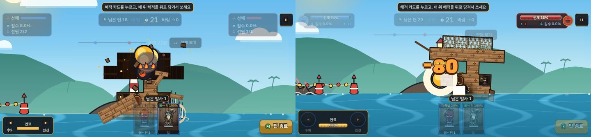
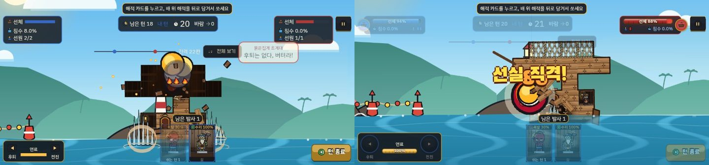
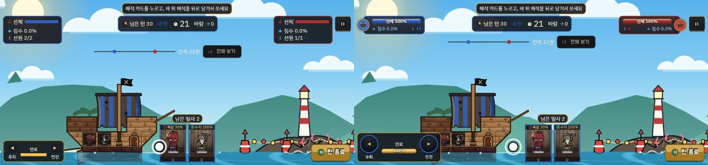
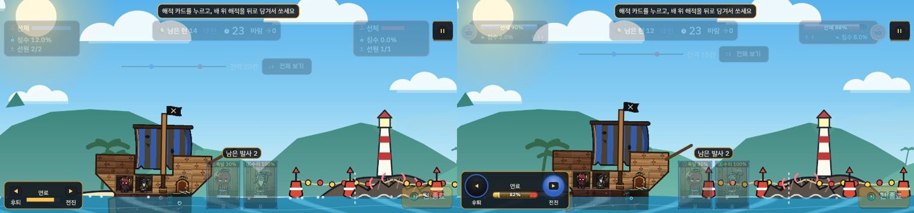
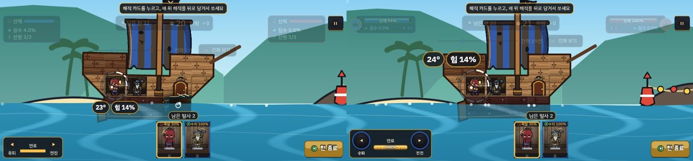
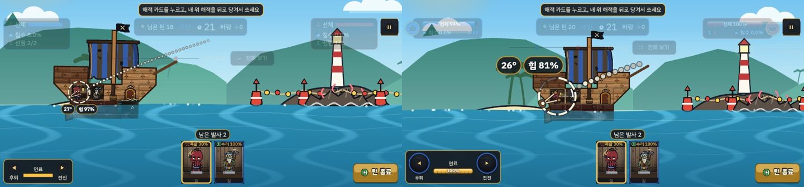
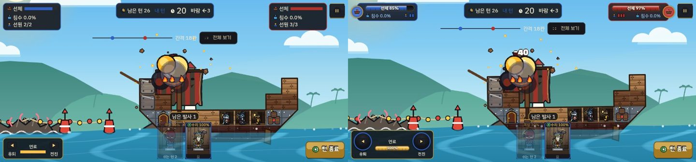
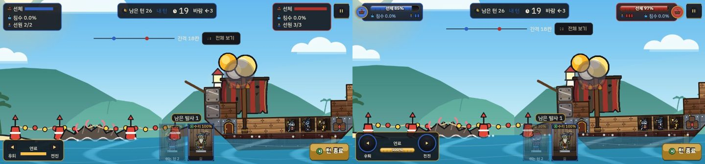

# 착탄 내구도·HUD·조준 전후 비교 (A33, 2026-10-07)

계획: [docs/plans/2026-10-06-quality-5-durability-aim.md](../plans/2026-10-06-quality-5-durability-aim.md) · 결정: ADR-088 · 앞 비교: [2026-10-06-hit-feel.md](2026-10-06-hit-feel.md)

## 방법
- 전: `2bec4b1`(A33 머지 직전 main). 후: `a1b7f58`(A33 머지). 두 커밋을 `git archive` 로 저장소 밖 임시 폴더에 꺼내 각각 웹 릴리스로 빌드했다.
- 헤드리스 Chrome(900×420)에서 원격 디버깅(CDP)으로 튜토리얼 1을 실제로 플레이했다. 내 턴이 시작되는 순간을 화면 색으로 잡아, 이동 버튼을 누르고, 해적을 끌어 쏘며 70ms 간격으로 연속 캡처했다.
- 같은 판을 그대로 재현할 수는 없어서 두 빌드의 배 간격과 착탄 지점이 조금 다르다. 전 빌드는 위 갑판에, 후 빌드는 선실에 맞았다.
- 각 이미지는 왼쪽이 전, 오른쪽이 후다.

## 착탄 순간의 내구도

| 착탄 직후 | 0.15초 뒤 |
|---|---|
|  |  |

| 항목 | 전 | 후 |
|---|---|---|
| 칸이 부서지는 때 | 탄이 날아가는 동안 이미 한 발의 최종 상태가 그려졌다. 폭발이 닿기 전에 위 갑판 한 줄이 통째로 검게 변했다(왼쪽) | 맞은 그 틱에만 바뀐다. 착탄 전에는 멀쩡하고, 맞은 칸만 번쩍인 뒤 금이 간다 |
| 상대 선체 막대 | 숫자 없이 막대만 있었다. 연출 중에는 HUD 전체가 흐려서 얼마나 깎였는지 보이지 않았다 | 맞는 순간 상대 패널만 0.9초 동안 또렷해진다. '선체 88%'가 보이고, 깎인 만큼 흰 꼬리가 남았다가 줄어든다 |
| 피해 숫자 | 이 캡처에서는 선체 피해 숫자가 보이지 않았다 | 한 발이 선체에 준 피해를 모아 큰 숫자 하나로 띄운다(−80). 여러 숫자가 겹치면 위로 비켜 쌓인다 |
| 카메라 | 맞은 곳을 가운데에 두고 당겼다 | 맞은 배 전체가 들어오게 맞추고 여백 90px을 둔다 |
| 턴 넘김 | 폭발이 끝나기 전에 HUD가 진하게 돌아오고 상대 대사가 떴다 | 착탄에 머무는 동안 HUD가 흐린 채로 있다 |

## HUD

- 선체 패널: 숫자 없는 막대와 침수·선원 세 줄짜리 상자에서, 아이콘·'선체 100%' 막대·침수·선원 점을 담은 작은 패널로 바꿨다. 위아래로 차지하는 높이가 줄어 배 돛이 덜 가린다.
- 내 쪽은 파랑, 상대 쪽은 빨강이다. 선체가 격침 기준 +10% 아래로 내려가면 경고색으로 천천히 맥박치고, 맞을 때마다 흔들린다(테스트 `hud_gauge_test`).

## 연료 HUD (이동 버튼을 누르고 있을 때)

- 전: 작은 화살표와 가는 막대뿐이었다. 남은 양을 숫자로 알 수 없었고, 누르고 있다는 표시도 없었다.
- 후: 버튼을 둥글게 키우고, 누르는 동안 버튼이 빛난다. 막대에 남은 비율(82%)을 적고, 이번 이동으로 쓸 연료를 막대 끝에 다른 색으로 미리 보여 준다(`fuelFor` 로 계산).

## 조준선

| 약하게 당김 (힘 14%) | 세게 당김 (힘 81~97%) |
|---|---|
|  |  |

- 각도·힘 글자: 전에는 해적 아래 카드 근처에 작게 떠서 손가락과 카드에 가렸다. 이제 해적의 뒤쪽 위(뒤 30px, 위 34px)에 크게 뜬다.
- 줌: 전에는 세게 당길수록 화면이 멀어져 배와 글자가 작아졌다(왼쪽 아래 '27° 힘 97%'). 이제 해적 발밑을 기준으로 1.1배에 고정하고, 점과 글자는 화면 크기에 맞춰 같은 크기로 그린다.
- 점선: 점이 같은 크기로 이어지던 선을, 앞쪽이 크고 뒤로 갈수록 작아지며 흐르는 선으로 바꿨다. 약하게 당기면 고무줄만 옅게 보인다.
- 손떨림: 놓는 순간 24px 안에서 흔들린 것은 무시하고(`steadyPx`), 조준은 손가락을 0.35 비율로 따라온다(`pull_aim_test`).

## 큰 배: 해역 1-5 (철판 방패 중간 보스)

진행 저장(IndexedDB 의 `progress` 상자)에 1-4까지 클리어한 기록을 넣어 1-5를 열고, 두 빌드에서 같은 힘(92%)으로 쏘았다. 두 빌드 모두 뱃머리 돛대 근처에 맞았다.

| 착탄 직후 | 0.14초 뒤 |
|---|---|
|  |  |

- 후 빌드에서는 맞는 순간 상대 패널이 또렷해져 '선체 97%'가 보이고 −40이 뜬다. 전 빌드에서는 패널이 진하게 돌아와 있지만 숫자가 없어 얼마나 깎였는지 알 수 없다.
- 간격 18칸에서는 전 빌드도 배 전체가 화면에 들어와서, 카메라 맞춤의 차이가 이 장면에서는 거의 드러나지 않았다. 배 전체 맞춤은 `render_test`(impact 맞춤)로 확인했다.
- **두 빌드에 같이 있는 문제(기록만):** 착탄 뒤 0.14초 만에 카메라가 내 배 쪽으로 돌아가기 시작해, 폭발 연기가 아직 남은 상대 배가 화면 오른쪽으로 밀려난다(오른쪽 그림). 이 장면은 내 턴의 첫 발이라 연출 뒤에도 내 턴이 이어지고, 카메라가 다음 조준을 위해 바로 돌아간다. A33이 바꾼 동작이 아니다.

## 캡처로 확인하지 못한 것 (테스트로만 확인)
- **붕괴로 떨어진 칸:** 손으로 쏘아서는 지지가 끊기는 붕괴를 만들지 못했다(앞 비교 A32와 같다). 지지가 끊겨 떨어진 칸은 빈칸으로 그리고, 네 이웃이 모두 빈 부서진 칸은 지운다. `damage_v3_test` 골든과 `live_grid_test` 로 확인했다.
- **전투 시작 타이머:** 첫 프레임들이 느려도 25초가 깎이지 않도록, 프레임이 3번 연속 0.05초 이하가 되거나 최대 8초가 지나야 타이머가 돈다(`StartGate`). 헤드리스 Chrome 은 처음부터 빨라서 두 빌드 모두 바로 25 → 24로 넘어갔다. CDP 로 CPU 를 6배 느리게 걸고 1-5에 출항해 보았지만, 두 빌드 모두 7초 동안 바다 그림이 그려지지 않은 채 25에 멈춰 있어 차이를 가를 수 없었다. `start_gate_test` 로 확인했고, 느린 실기기 확인은 이월이다.
- 소리와 진동은 헤드리스라 확인하지 못했다.
