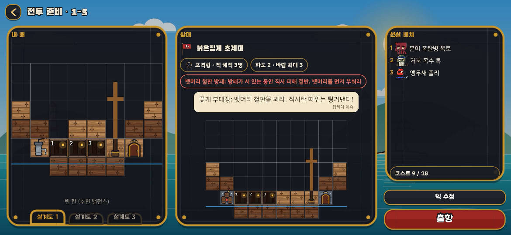
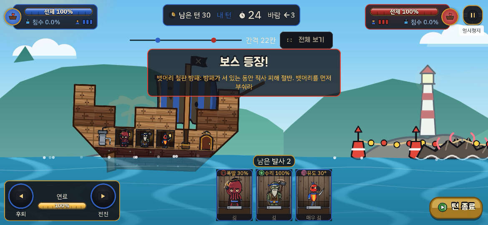
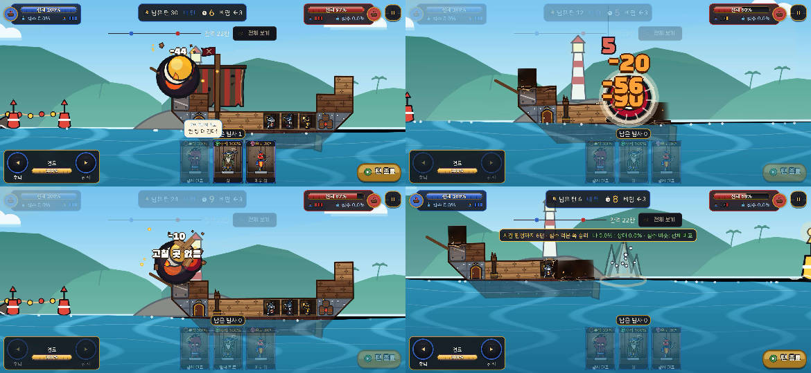
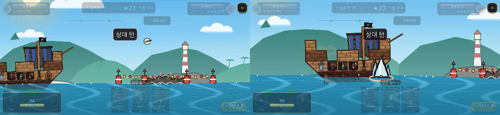
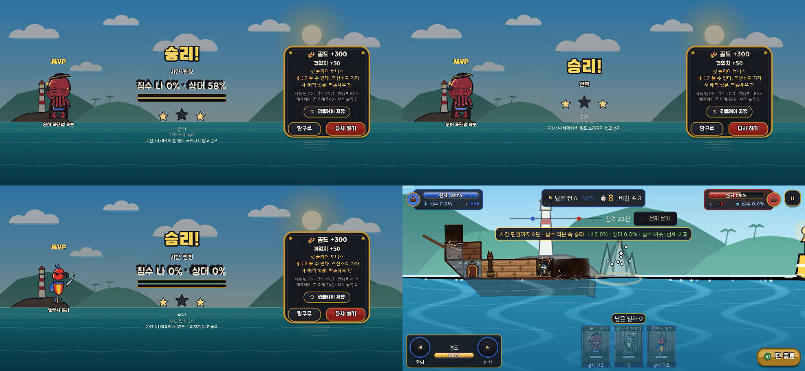
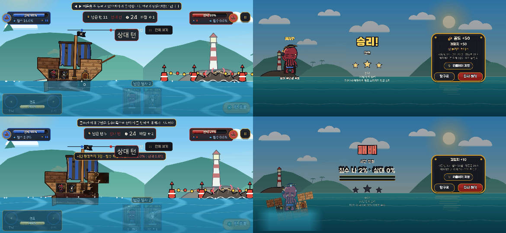

# A43 에이전트 플레이 점검: 1-5 방패(모든 계열)·튜토리얼 2·3 (2026-10-12)

지난 점검: [2026-10-07-a41-play-audit.md](2026-10-07-a41-play-audit.md). 결정: ADR-094.

> **결론부터.**
> - **1-5는 어렵지도 답답하지도 않고, 여전히 '구경하는 판'이다.** 2단계 배에 옥토·톡·폴리로 세 판을 했다. 모두 이겼고(별 2), **세 판 모두 받은 피해가 0**이었다(선체 100%, 침수 0%). 적 쉬움 AI는 턴마다 한 발을 쏘지만 매번 내 뱃머리 앞 바다에 떨어졌다. 방패가 블록 피해를 반으로 줄여도 판이 길어질 뿐 질 위험은 생기지 않았다. 폴리 유도탄이 선실로 들어가 해적을 쓰러뜨리는데, 해적 피해는 방패와 관계가 없다. 시뮬의 승률 하락(72~95% → 27~75%)은 앱에서 재현되지 않았다.
> - **방패가 '모든 계열'로 바뀐 것이 화면에 반영되지 않았다.** 전투 준비 칩, '보스 등장!' 배너, 꽃게 부대장 대사가 모두 아직 "직사 피해 절반"·"직사탄 따위는 튕겨낸다"고 말한다(ko·en 모두). 방패 철판은 보이지만 갑판 쪽 철판과 구별하기 어렵다. 피해가 반으로 줄었다는 표시도 없다. 아래쪽 방패 칸 하나는 세 판 내내 깨지지 않았고, 뱃머리를 먼저 노린 판에서도 그대로 남았다.
> - **튜토리얼 2는 이기고, 튜토리얼 3은 시간 판정 침수 2% : 0%로 졌다.** 톡 수리가 물도 빼는 것은 확인했다(침수 4.0% → 0.0%, 선체 85 → 100%). 그 뒤 상대(뿜뿜, 침몰형)가 내 뱃머리와 선장실을 부숴 침수 2%가 생겼다. 펌프가 없는 1단계 배라 이 물은 끝까지 남았다. 튜토리얼 2 대사는 아직 "이번엔 둘이다"인데, 상대는 1명이다.

## 방법
- **빌드:** main `f852c5a`(A43 병합). 임시 worktree `D:/Projects/pb-audit-a43`에서 `flutter create --platforms=web` 뒤 `flutter build web --release`로 만들었다. puppeteer-core와 Chrome 프로필도 이 worktree 안 `_tmp`에 두었다. 점검이 끝난 뒤 worktree를 통째로 지웠다.
- **실행:** 헤드리스 Chrome(GPU ANGLE d3d11)으로 1170×540·2배 밀도로 띄웠다. 브라우저를 계속 붙잡고 있는 작은 명령 서버로 조작했다. 내 턴은 '턴 종료' 버튼의 금색 픽셀과 '남은 발사' 알약의 어두운 픽셀로 감지했다.
- **조준:** 카드를 누르고 1.3초 기다리면 고른 해적이 (453, 272) 근처로 확대된다(튜토리얼 1단계 배는 (453, 262)). 그 점에서 당겼다. 기본은 (−222, +88), 뱃머리를 노릴 때는 (−195, +78)로 약하게, 무시할 때는 (−255, +100)으로 멀리 당겼다. 간격은 모든 판에서 22칸이었다.
- **저장:** IndexedDB `progress/box/state`를 고쳤다.
  - 1-5: 레벨 4, 골드 300, 별 t-1~t-3·1-1~1-4, `tutorialDone 3`, 보유 `p26_polly`, `ship.stage 2`(추천 밸런스, 선실 3·펌프 있음), 덱 `fleet/box/deck` = 옥토·톡·폴리. 전투 준비 화면이 이 덱을 그대로 받았다(코스트 9/18).
  - 튜토리얼 2: `tutorialDone 1`, 별 t-1. 튜토리얼 3: `tutorialDone 2`, 별 t-1·t-2. 둘 다 1단계 배, 기본 덱(옥토·톡).
- **판별 계획:** 1-5 (1) 옥토는 뱃머리, 폴리는 기본 조준. (2) 방패 무시: 옥토·폴리 모두 멀리. (3) 방패 먼저: 1~4턴은 옥토·톡을 뱃머리에 쏘고, 5턴부터 옥토·폴리(선체 95% 미만이면 톡).
- **한계**
  - 자동 조작은 바람과 무너진 배 모양에 맞춰 조준을 고치지 않는다. (3)에서 적 배 뒤쪽이 날아간 뒤 같은 조준이 계속 바다에 떨어졌다. 명중률이 44%로 낮은 이유다.
  - 튜토리얼 2·3의 첫 턴에는 자동 조작이 쏘지 못했다. 안내 손가락이 떠 있어 카드 입력이 먹지 않은 것으로 보인다. 사람이라면 손가락을 따라 쐈을 것이다.
  - 쏜 뒤 캡처 때문에 턴 시간 일부를 썼다. 벽시계는 실제보다 조금 길다.
  - 같은 조건의 시험 판 하나(조작 도구 점검)와 도구가 멈춰 무효가 된 판 하나는 표에서 뺐다. 두 판 모두 받은 피해는 0이었다.

## 판 결과
벽시계는 출항부터 결과 직전 대사까지다. '받은 피해'는 HUD 선체·침수 기준이다.

| 판 | 편성 | 계획 | 벽시계 | 턴 | 결과 | 발사 | 명중률 | 준 피해·부순 블록 | 받은 피해 | 별 |
|---|---|---|---|---|---|---|---|---|---|---|
| 1-5 (1) | 옥토·톡·폴리, 2단계 | 옥토 뱃머리 | 약 350초 | 30 | 시간 판정 **승리**(침수 0% : 58%) | 29 | 62% | 740 · 5 | **0** | 2 |
| 1-5 (2) | 같음 | 방패 무시 | 약 245초 | 22 | **전멸 승리** | 15 | 100% | 866 · 5 | **0** | 2 |
| 1-5 (3) | 같음 | 방패 먼저 | 약 350초 | 30 | 시간 판정 **승리**(0% : 0%, 선체 100 : 58) | 29 | 44% | 562 · 4 | **0** | 2 |
| 튜토리얼 2 | 옥토·톡, 1단계 | 기본 | 약 260초 | 24 | **전멸 승리** | 22 | 31% | 316 · 4 | 선체 90%, 침수 16%(중반 기준) | 3 |
| 튜토리얼 3 | 옥토·톡, 1단계 | 1턴 톡 먼저 | 약 335초 | 30 | 시간 판정 **패배**(침수 2% : 0%) | 16 | 25% | 24 · 2 | 시작 85% → 수리 100% → 끝 90%, 침수 4% → 0% → **2% 고정** | 0 |

- 1-5 별 2는 모두 '승리'와 미션 '해적이 한 명도 쓰러지지 않음'이다. '12턴 안에 승리'는 세 판 모두 놓쳤다. 가장 빠른 (2)도 사용 턴 22였다.
- 1-5에서 적 해적은 (1)·(2)에서 2명이 일찍 쓰러졌다. 폴리 유도탄이 선실 쪽으로 휘어 들어가 -90·-56·-20이 한 번에 났다(아래 사진).
- 적 쉬움 AI는 턴마다 한 발을 쏘았다. 본 것은 모두 내 뱃머리 앞에 떨어진 물보라였다. 세 판에서 적 턴은 45번가량이었고, 맞은 적이 한 번도 없다.

## 화면에서 이해되는지
| 장면 | 화면 | 관찰 |
|---|---|---|
| 전투 준비 칩 |  | 빨간 칩: "뱃머리 철판 방패: 방패가 서 있는 동안 **직사 피해 절반**. 뱃머리를 먼저 부숴라". 꽃게 부대장 대사도 "**직사탄 따위는** 튕겨낸다!"다. A43 규칙(모든 계열 블록 피해 50%)과 다르다. 옥토·톡·폴리는 직사가 아니어서, 이 글만 보면 "내 덱은 상관없다"고 읽게 된다. 적 배 그림에는 방패 칸 표시가 없다 |
| 보스 배너 |  | '보스 등장!' 배너도 같은 옛 문구다. 배너가 떠 있는 동안 타이머가 흘러 첫 턴이 24초에서 시작했다(지난 점검 버그 3, 그대로) |
| 방패 착탄 |  | 왼쪽 위: 뱃머리 위쪽 방패 칸에 옥토 -44. 오른쪽 위: 폴리 유도탄이 선실로 들어가 피해 숫자 세 개가 겹쳤다. 왼쪽 아래: 톡이 뱃머리를 맞혀 -10과 '고칠 곳 없음' 이름표가 떴다(ADR-094 이름표 수정 확인). 오른쪽 아래: (3) 끝 무렵이다. 적 배 뒤쪽이 날아갔는데 뱃머리 아래 방패 철판은 남아 있다. 철판은 반짝임이 지나가 눈에 띈다. 그러나 배 아래 모서리의 철 블록(장갑 프리셋)도 리벳 모양이라, 어디까지가 방패인지 헷갈린다. 피해 숫자가 반으로 줄었다는 표시('방패' 이름표 등)는 없다 |
| 적 착탄 |  | 1-5 적 턴. 탄이 날아와(왼쪽) 내 뱃머리 앞 바다에 물보라를 일으킨다(오른쪽). 세 판 내내 같은 모양이었다 |
| 1-5 결과 |  | (1) 시간 판정 0% : 58%, (2) 전멸, (3) 시간 판정 0% : 0%. 오른쪽 아래는 (3) 중반이다. 적 배 뒤쪽이 사라져 자동 조준이 뒤 바다로 넘어갔고, 남은 칸(뱃머리 방패·선장실)은 끝까지 섰다 |
| 튜토리얼 2·3 |  | 왼쪽 위: 튜토리얼 2 중반. 상대 수리(포격형)는 1명이어도 내 배를 맞힌다(선체 90%, 침수 16%). 오른쪽 위: 전멸 승리, 별 3. 왼쪽 아래: 튜토리얼 3 중반. 내 뱃머리·선장실이 부서져 두 카드가 '쉬는 턴 1'이고, 침수 2.0%가 남았다. 오른쪽 아래: 시간 판정 패배 2% : 0% |

- **방패 효과를 이해할 수 있는가:** 거의 안 된다. 글은 '직사만'이라고 하고, 피해 숫자에 반감 표시가 없다. 방패가 깨질 때의 알림도 보지 못했다(아래 칸이 끝까지 남아서). 위쪽 방패 칸이 깨졌을 때도 다른 블록과 같은 파편 연출뿐이었다.
- **방패가 판에 주는 영향:** 블록 피해만 줄이므로, 선실 직격으로 해적을 쓰러뜨리는 폴리 편성에는 거의 영향이 없다. (2)는 방패가 선 채로 22턴 만에 전멸로 끝났다. (1)·(3)은 30턴을 채웠지만, 이유는 방패보다는 적 배 뒤쪽이 날아간 뒤 조준을 고치지 않은 자동 조작 쪽이 크다.
- **튜토리얼 3 수리:** 1턴을 놓쳐 침수 4.0%가 된 뒤, 톡 명중 한 번에 선체 100%·침수 0.0%로 돌아왔다(A41 버그 2의 '물이 남는' 문제는 이 경로에서 해결). 진 이유는 다른 데 있었다. 상대 뿜뿜이 뱃머리를 부숴 생긴 2%가 펌프 없는 배에 끝까지 남았고, 내 탄은 짧아진 상대 배를 넘어갔다.

## 버그·화면 결함
| # | 내용 | 근거 |
|---|---|---|
| 1 | **1-5 방패 문구가 A43 규칙과 다르다.** 칩·배너 글은 "직사 피해 절반"("direct fire deals half damage")이다. 규칙은 모든 계열 블록 피해 50%로 바뀌었다(`shieldPercent`에서 계열 검사가 빠짐) | `app/lib/l10n/app_ko.arb:323`, `app/lib/l10n/app_en.arb:588`, `packages/pb_sim/lib/src/match/boss_gimmick.dart:87` |
| 2 | 1-5 꽃게 부대장 대사도 직사만 막는다고 말한다. "직사탄 따위는 튕겨낸다!" / "Your bullets bounce right off!" | `app/lib/l10n/app_ko.arb:291`, `app/lib/l10n/app_en.arb:532` |
| 3 | **튜토리얼 2 대사가 상대 2명 기준이다.** "이번엔 둘이다" / "Two of us this time". A43에서 상대가 1명(수리)이 되었다. 전투 준비 칩은 '적 해적 1명'이라 같은 화면 안에서 서로 다르다. 상대 배 그림의 선실 2칸 중 하나는 빈 채로 그려진다(작음) | `app/lib/l10n/app_ko.arb:279`, `app/lib/l10n/app_en.arb:520`, `app/assets/stages/sea1.json:17` |
| 4 | 보스 배너가 떠 있는 동안 턴 타이머가 흐른다. 1-5 첫 턴이 24초에서 시작했다(지난 점검 버그 3, 미해결) | 보스 배너 캡처 |
| 5 | (확인 필요) **1-5 적 쉬움 AI가 22칸에서 한 번도 맞히지 못한다.** 세 판, 적 턴 약 45번 모두 내 뱃머리 앞에 떨어졌다. 튜토리얼 2(쉬움, 같은 22칸)의 수리는 내 배를 맞혔다. 1-5 적 해적·바람(←3)·쉬움 다이얼(각도 오차 8°, 바람 보정 50%) 조합이 늘 짧게 쏘는 것으로 보인다. 시뮬이 말한 '플레이어 승률 27~75%'와 맞지 않는다. 원인은 코드로 확인하지 않았다 | `packages/pb_ai/lib/src/dials.dart:32`, `app/assets/stages/sea1.json:64` |
| 6 | 상대 턴의 '상대 턴' 표시가 시간 판정 띠 가운데를 덮어 글자가 가려진다(작음) | 1-5 (1) 26턴 캡처 |

## 제안
`[규칙·수치]`는 설계서·BALANCE.md 수정 승인이 먼저 필요하다. `[앱]`은 화면만 고친다.

1. **[앱] 방패 문구를 A43 규칙에 맞춘다**(버그 1·2). ko·en을 같은 커밋에서 고친다. 예: "뱃머리 철판 방패: 방패가 서 있는 동안 블록 피해 절반. 뱃머리를 먼저 부숴라". 대사: "이 철판 앞에선 어떤 탄도 반토막이다!"
2. **[앱] 튜토리얼 2 대사를 1명 기준으로 고친다**(버그 3). 예: "이번엔 거리를 벌려서 쏴 주지!"
3. **[앱] 방패 효과가 보이게 한다.**
   - 방패가 선 동안 블록에 맞은 피해 숫자 옆에 '방패' 작은 이름표나 방패 아이콘을 붙인다.
   - 마지막 방패 칸이 부서지면 '방패 깨짐!' 이름표를 띄운다.
   - 전투 준비 화면의 적 배 그림에도 방패 칸을 표시한다. 방패 철판 색을 장갑 프리셋의 철 블록과 다르게 한다(예: 금색 테두리).
4. **[규칙·수치] 1-5 적이 실제로 위협이 되게 한다**(버그 5). 방패 범위만 넓혀서는 '구경 판'이 바뀌지 않는다. 먼저 1-5 적의 명중 원인을 확인한다(`sim_runner`에 1-5 편성으로 적 쪽 명중률을 잰다). 그다음 다음 중 하나를 고른다.
   - 1-5만 AI '쉬움'과 '보통' 사이 다이얼(바람 보정 75% 등)을 둔다(A41 제안 4).
   - 적 덱에 곡사 해적을 하나 넣는다.
   - 시뮬 승률은 '내 쪽 AI'가 방패 앞에서 약한 탓일 수 있다. 사람 조준과 비슷한 다이얼로 다시 잰다.
5. **[규칙·수치] 방패가 폴리 편성에도 의미가 있게 할지 정한다.** 지금은 선실 직격(해적 피해)이 방패를 지나쳐 간다. 방패가 선 동안 선실·해적 피해도 줄일지, 아니면 '뱃머리를 깨야 선실이 열린다'처럼 칸 배치로 풀지 정한다(설계서 §5.4).
6. **[규칙·수치] 1-5 '12턴 안에 승리' 별을 다시 본다.** 가장 쉬운 판도 사용 턴 22였다. 별 기준이 양쪽 턴 합인지 내 턴 수인지 결과 화면에 적는다. 또는 기준을 늘린다.
7. **[규칙·수치] 튜토리얼 3의 '남은 물' 패배.** 수리로 물을 빼는 것은 됐다. 그래도 상대에게 맞아 생긴 물이 펌프 없는 배에 남으면 2% : 0% 같은 작은 차이로 진다. 튜토리얼 3만 펌프를 주거나, 시간 판정에서 침수 차가 작으면(예: 5%p 이내) 선체 비교로 넘기는 방안을 검토한다(A41 제안 2의 나머지).
8. **[앱] 보스 배너 동안 타이머를 멈춘다**(버그 4).

## 확인하지 못한 것
- 사람이 방패 아래 칸까지 정확히 노려 방패를 완전히 깼을 때의 화면(깨짐 연출·이후 피해 숫자 변화)을 보지 못했다. 세 판 모두 아래 칸이 남았다.
- 피해 숫자가 실제로 반으로 줄었는지는 같은 탄의 방패 전후 비교가 없어 화면으로 확인하지 못했다.
- 1-5 적이 늘 짧게 쏘는 원인(해적·바람·AI 다이얼)은 코드를 따라가지 않았다.
- 튜토리얼 2·3 첫 턴에 자동 조작 입력이 먹지 않은 이유(안내 손가락 때문인지).
- 1-5를 덱 옥토·톡(폴리 없이)으로 하지 않았다. 영어 화면·소리·실기기도 보지 않았다.
